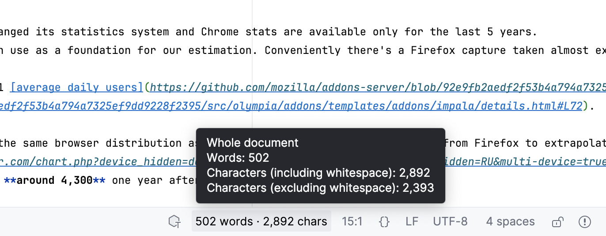
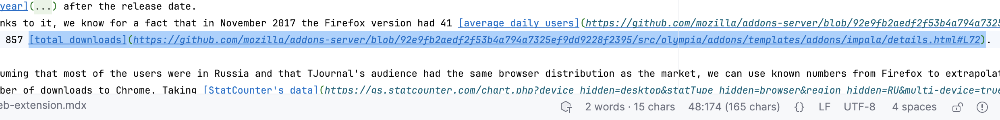
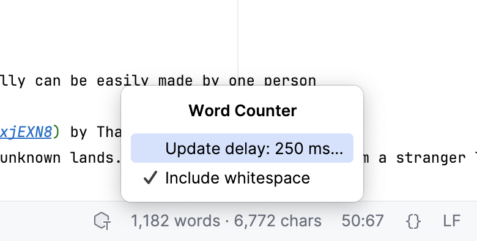

# Word Counter

Word and character counts in the status bar of IntelliJ-based IDEs for plain text,
Markdown, and MDX. Free and open source under the [MIT license](LICENSE).



## Key Features

- Live totals for the whole document or selected text, including multiple carets.
- Supports `.txt`, `.text`, `.md`, `.markdown`, and `.mdx` files.
- Markdown-aware counting excludes frontmatter, formatting, link URLs, images,
  and code blocks.
- Counts literal MDX text without evaluating components or expressions.
- Click the counter to adjust the update delay and include or exclude whitespace.

<details>
<summary>Selection counts and settings</summary>


A 146 characters-long URL is not counted towards total amount


Settings pop-up
</details>

## Download

[Install Word Counter from JetBrains Marketplace](https://plugins.jetbrains.com/plugin/35493-word-counter)

Or open **Settings > Plugins > Marketplace** in your IDE, search for **Word Counter**
by **Roman Evtushenko**, and click **Install**.

For manual installation, [download Word Counter 1.0.1](word-counter.zip?raw=true):

1. Open **Settings > Plugins**, then the gear menu > **Install Plugin from Disk**.
2. Select the downloaded ZIP without extracting it. Restart the IDE if prompted.

The counter appears beside the line/column indicator when a supported file is open.

## Build From Source

Requires **JDK 25**, with `JAVA_HOME` pointing to its installation. Gradle is
provided by the wrapper; no separate Gradle installation is needed.

```sh
git clone https://github.com/x-ider/word-counter-plugin.git
cd word-counter-plugin
./gradlew test buildPlugin
```

On Windows, use `gradlew.bat` instead of `./gradlew`. The first build downloads
Gradle, dependencies, and the IntelliJ IDEA SDK.

The installable ZIP is written to `build/distributions/word-counter-1.0.1.zip`.
Install it using the same steps as above.

## Supported Versions

Supports JetBrains IDEs from **2026.1 onwards**.
